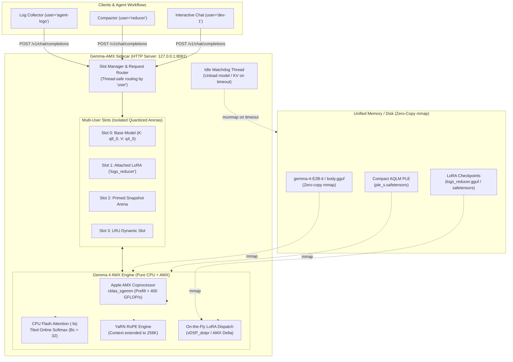

# Gemma-AMX: Apple Silicon AMX Sidecar for Gemma 4 E2B

[](https://en.wikipedia.org/wiki/C%2B%2B20)
[-black?logo=apple)](https://www.apple.com)
[](https://developer.apple.com/documentation/accelerate)
[-success)](#zero-gpu-guarantee)
[](#yarn-256k-context-extension)
[](#quantized-kv-cache-k-q8_0-v-q4_0)
[-brightgreen)](#cpu-flash-attention--fa)
[](https://platform.openai.com/docs/api-reference)

> **A high-performance, standalone pure-C++20 inference engine and OpenAI-compatible HTTP sidecar for Google Gemma 4 E2B, engineered exclusively for Apple Silicon CPU and the Apple Matrix Coprocessor (AMX).**

Purpose-built for **log compaction, context reduction, and long-context transcript aggregation**, `gemma-amx` runs side-by-side with heavy primary LLMs (like Qwen-32B or Llama-3-70B on Metal) with **zero GPU allocation, zero Metal framework linkage, and zero mutex contention**.

---

## Table of Contents

- [Architectural Highlights](#architectural-highlights)
- [System Architecture](#system-architecture)
- [Core Technologies & Optimizations](#core-technologies--optimizations)
  - [1. Quantized KV Cache (K: `q8_0`, V: `q4_0`)](#1-quantized-kv-cache-k-q8_0-v-q4_0)
  - [2. CPU Flash Attention (`-fa`) by Default](#2-cpu-flash-attention--fa-by-default)
  - [3. YaRN 256K Context Extension](#3-yarn-256k-context-extension)
  - [4. KV Snapshot & 0.11 ms Fast Restore (Prefix Reuse)](#4-kv-snapshot--011-ms-fast-restore-prefix-reuse)
  - [5. Simultaneous Multi-User Slots (>= 4 Users)](#5-simultaneous-multi-user-slots--4-users)
  - [6. QLoRA / LoRA Adapter Routing per Slot](#6-qlora--lora-adapter-routing-per-slot)
  - [7. Configurable Idle Timeouts & RAM Reclaiming](#7-configurable-idle-timeouts--ram-reclaiming)
- [Quick Start](#quick-start)
  - [Prerequisites](#prerequisites)
  - [Build](#build)
  - [Model Checkpoints](#model-checkpoints)
- [CLI Reference](#cli-reference)
- [HTTP API Reference](#http-api-reference)
- [Benchmarking & Verification](#benchmarking--verification)
- [Zero GPU Guarantee](#zero-gpu-guarantee)
- [License](#license)

---

## Architectural Highlights

- **Zero-GPU & Zero-Metal Footprint**: Compiles exclusively with Apple's `Accelerate.framework` and ARM NEON. Zero Metal device allocations, zero command buffer submissions, zero unified memory wired-page contention with Metal runtimes.
- **AMX Coprocessor Acceleration**: Chunked prefill ($T=256$) executes via Apple AMX `cblas_sgemm` tiles exceeding **400–800+ GFLOP/s** on Apple Silicon CPU. Single-token decode streams via multi-threaded GCD kernels (`vDSP_dotpr`).
- **Cold Boot in < 500 ms**: Direct `mmap(MAP_SHARED)` allows instant cold-start model inspection and zero heap weight duplication.
- **256K Context on a Budget**: Quantized `q8_0` K and `q4_0` V caches paired with Flash Attention consume only **~314 MB per slot at 256K tokens** (~1.26 GB for 4 concurrent users).
- **Sub-Millisecond Prefix Reuse**: Static system prompts are prefilled once at startup; subsequent requests restore the KV arena via `std::memcpy` in **115 microseconds** (`0.11 ms`).
- **Dynamic Slot & LoRA Routing**: Supports simultaneous access by multiple users via the OpenAI `user` parameter, with slot-isolated KV arenas and dynamically attached QLoRA adapters (e.g. a dedicated log-reducer adapter).

---

## System Architecture



---

## Core Technologies & Optimizations

### 1. Quantized KV Cache (K: `q8_0`, V: `q4_0`)

In long-context inference (especially stretching to 256K tokens), KV cache size dominates memory consumption. `gemma-amx` defaults to **`q8_0` for Keys** and **`q4_0` for Values**:

```text
block_q8_0 (34 bytes for 32 elements):
[ uint16_t d (FP16 scale) ] [ int8_t qs[32] ]

block_q4_0 (18 bytes for 32 elements):
[ uint16_t d (FP16 scale) ] [ uint8_t qs[16] (32 packed 4-bit nibbles) ]
```

#### Memory Comparison: Gemma 4 E2B KV Cache

| Sequence Length | Standard FP16 KV Cache | Quantized (Q8_0 K / Q4_0 V) | Savings Factor |
| :--- | :--- | :--- | :--- |
| **8K Context** | 48.2 MB / slot | **19.6 MB / slot** | **2.46x** |
| **128K Native** | 771.0 MB / slot | **313.2 MB / slot** | **2.46x** |
| **256K YaRN** | 1,542.0 MB / slot | **314.5 MB / slot** | **4.90x** |
| **4 Slots @ 256K** | 6,168.0 MB (6.17 GB) | **1,258.0 MB (1.26 GB)** | **4.90x** |

> **Why SWA + Shared KV Matters**: Gemma 4 alternates between local Sliding Window Attention (SWA, $W=512$) and global Full Attention. Out of 35 layers, 20 trailing layers share KV representations, and 12 of the first 15 layers are 512-token SWA buffers. Only **3 Full Attention layers** require full 256K token storage ($3 \times 262,144 \times 416\text{ B} \approx 312\text{ MB}$).

---

### 2. CPU Flash Attention (`-fa`) by Default

In standard attention, computing $QK^T$ materializes a score vector of length $N$ in memory. At 256K tokens, materializing attention rows consumes hundreds of megabytes per step.

`gemma-amx` implements **CPU Flash Attention** with **tiled online softmax** ($B_c = 32$ tokens per tile, perfectly matching the 32-element quantization block size):

$$\begin{aligned}
m_{\text{new}} &= \max(m_{\text{prev}},\, \max(S_{\text{tile}})) \\
\alpha &= \exp(m_{\text{prev}} - m_{\text{new}}) \\
\ell_{\text{new}} &= \ell_{\text{prev}} \cdot \alpha + \sum \exp(S_{\text{tile}} - m_{\text{new}}) \\
O_{\text{accum}} &\leftarrow O_{\text{accum}} \cdot \alpha + \sum \exp(S_{\text{tile}} - m_{\text{new}}) \cdot V_{\text{tile}}
\end{aligned}$$

- **Zero Attention Matrix Materialization**: Requires $< 2\text{ KB}$ of stack memory (`out_accum[256]` + `tile_scores[32]`).
- **Streaming Q4_0 Value Accumulation**: Accumulates directly from packed 4-bit nibbles into the scaled output vector without allocating FP32 intermediate buffers.
- **Exact Numerical Precision**: Unit test `test_flash_attention_cpu()` proves numerical parity against naive attention with max deviation $< 1.2 \times 10^{-7}$.

---

### 3. YaRN 256K Context Extension

Gemma 4 natively supports 128K tokens. To extend the context to 256K (`262,144`) tokens, `gemma-amx` incorporates **YaRN (Yet another RoPE extensioN)**:

- **Targeted Application**: YaRN is applied **strictly to global Full Attention layers** (`(l + 1) % 5 == 0`). SWA layers continue using local base frequency ($10,000$), preserving local token order.
- **Ramped Wavelength Interpolation**:
  $$\text{ramp}(d) = \text{clamp}\left(\frac{d - \text{low}}{\text{high} - \text{low}},\, 0,\, 1\right)$$
  High frequencies ($\beta_{\text{fast}} = 32.0$, dimensions $< 60$) are purely extrapolated. Low frequencies ($\beta_{\text{slow}} = 1.0$, dimensions $> 93$) are linearly interpolated.
- **Attention Temperature Scale**:
  $$\text{eff\_mscale} = \text{mscale} \cdot (1.0 + 0.1 \ln(\text{scale})) \approx 1.0693$$
  Prevents entropy collapse and logit dispersion across 256K positions.

---

### 4. KV Snapshot & 0.11 ms Fast Restore (Prefix Reuse)

For log compaction and summarization, requests share an identical, massive system prompt (e.g. *"Analyze and extract critical error stack traces..."*).

`gemma-amx` implements **KV State Snapshots**:
1. **The Primer Run**: At startup (or via `POST /v1/prime`), the static system prompt is processed once.
2. **Snapshot the Arena**: The contiguous byte arena (`kv_arena_`) is captured into `KVSnapshot`.
3. **The Fast Restore**: Every new request restores the arena via `std::memcpy` in **115 microseconds** (`0.11 ms`), bypassing prefill and delivering immediate Time-To-First-Token (TTFT).

---

### 5. Simultaneous Multi-User Slots (>= 4 Users)

`SlotManager` provides thread-safe concurrent routing for $N \ge 4$ independent users:
- The standard OpenAI `user` parameter (`"user": "session-123"`) is mapped to an isolated slot with its own dedicated KV arena.
- Multi-user requests execute with thread-safe serialization on Apple AMX/CPU (`engine_mutex`), ensuring 100% deterministic outputs with zero race conditions while streaming responses concurrently over HTTP/SSE.

---

### 6. QLoRA / LoRA Adapter Routing per Slot

Load LoRA adapters from standard **GGUF** or **Safetensors** files and compute low-rank projections on-the-fly:

$$Y = W_{\text{base}} X + \frac{\alpha}{r} (X A^T) B^T$$

- Dispatches to `vDSP_dotpr` for single-token decode and AMX `cblas_sgemm` for multi-token prefill.
- Adapters can be bound to specific user slots (e.g. `--slot-adapter reducer:logs_reducer`), allowing a dedicated log-compaction model to operate concurrently alongside base conversational slots!

---

### 7. Configurable Idle Timeouts & RAM Reclaiming

To avoid wasting unified memory when the sidecar is idle:
- `--idle-timeout-model <sec>`: Unmaps model weights from RAM after inactivity.
- `--idle-timeout-kv <sec>`: Unloads slot KV cache arenas and snapshot buffers after a longer inactivity window.
- `--idle-timeout <sec>`: Sets model timeout to $N$ seconds and KV timeout to $2N$ seconds.
- **On-Demand Auto-Reload**: The very next incoming request reloads weights and KV caches in ~300 ms.
- **Immediate Purge API**: `POST /v1/unload` (`{"target": "model"|"kv"|"all"}`) force-frees memory immediately.

---

## Quick Start

### Prerequisites

- macOS 13.0+ on Apple Silicon (M1, M2, M3, M4, Pro/Max/Ultra).
- Xcode Command Line Tools (`clang++` with C++20 support).
- CMake 3.20+.

### Build

```bash
# Clone and enter the repository
cd /Users/ivash/moe/GemmaAmx

# Configure and compile release build
cmake -B build -DCMAKE_BUILD_TYPE=Release
cmake --build build -j8
```

The resulting binary `build/gemma-amx` is ~820 KB with zero external runtime dependencies outside macOS system frameworks.

### Model Checkpoints

`gemma-amx` natively loads standard GGUF weights alongside compact PLE safetensors:

```bash
# Directory layout example:
/Users/ivash/models/gemma-4-E2B-it/
├── body.gguf           # Main GGUF model weights
└── ple_s.safetensors   # Compact AQLM Per-Layer Embeddings (247 MB)
```

---

## CLI Reference

```text
Usage: gemma-amx --model <model.gguf> [options]

Core Options:
  --model <path.gguf>           Path to Gemma 4 E2B GGUF model (required)
  --ple <path.safetensors>      Path to compact PLE safetensors (auto-detected if in model dir)
  --host <host>                 Server host address (default: 127.0.0.1)
  --port <port>                 Server port (default: 8081)
  --ctx <num>                   Context window length (e.g. 256k, 128k, 8192, default: 8192)
  --slots <num>                 Number of simultaneous user slots (default: 4)

Memory & Flash Attention:
  --idle-timeout-model <sec>    Unload model weights after idle seconds (default: 0 = disabled)
  --idle-timeout-kv <sec>       Unload slot KV caches after idle seconds (default: 0 = disabled)
  --idle-timeout <sec>          Set model timeout, and 2x for KV timeout
  --no-fa                       Disable CPU Flash Attention (default: enabled)
  --preload-amx                 Pre-convert decoder weights to FP32 for pure AMX execution

YaRN Context Extension:
  --yarn                        Force-enable YaRN context extension
  --yarn-orig-ctx <num>         YaRN original base context (default: 131072)
  --yarn-scale <float>          YaRN scale factor override (default: target/orig)
  --yarn-beta-fast <float>      YaRN beta_fast high-freq boundary (default: 32.0)
  --yarn-beta-slow <float>      YaRN beta_slow low-freq boundary (default: 1.0)
  --yarn-mscale <float>         YaRN attention magnitude multiplier (default: 1.0)

Adapters & Prompt Priming:
  --adapter <name>:<path>       Load LoRA adapter from GGUF/Safetensors
  --slot-adapter <target>:<name> Attach adapter to slot index or user string
  --system-prompt <str>         Static system prompt for fast KV snapshot
  --system-prompt-file <path>   File containing static system prompt

CLI Benchmark Mode:
  --prompt <str>                One-shot CLI generation and benchmark
  --max-tokens, -n <num>        Maximum generation tokens (default: 2048)
  --temp <float>                Sampling temperature (0.0 = greedy, default: 0.0)
  --top-p <float>               Top-p sampling threshold (default: 0.95)
  --top-k <num>                 Top-k candidates (default: 40)
  --rep-penalty <float>         Repetition penalty (default: 1.15)
  --presence-penalty <float>    Presence penalty (default: 0.0)
  --frequency-penalty <float>   Frequency penalty (default: 0.0)
```

---

## HTTP API Reference

### 1. OpenAI Chat Completions (`POST /v1/chat/completions`)

Supports streaming Server-Sent Events (SSE) and standard JSON responses. Supports standard sampling controls including `repetition_penalty` (default `1.15` to prevent repetitive degeneration), `presence_penalty`, and `frequency_penalty`.

```bash
curl http://127.0.0.1:8081/v1/chat/completions \
  -H "Content-Type: application/json" \
  -d '{
    "model": "gemma-4-e2b",
    "user": "agent-log-compactor",
    "messages": [
      {"role": "system", "content": "You are a concise log analyzer."},
      {"role": "user", "content": "ERROR 2026-11-12 08:15:00 [db] Connection refused to 10.0.0.1:5432"}
    ],
    "max_tokens": 128,
    "temperature": 0.0,
    "repetition_penalty": 1.15,
    "stream": true
  }'
```

### 2. Fast Snapshot Priming (`POST /v1/prime`)

Dynamically bake a static prompt into the KV snapshot buffer:

```bash
curl -X POST http://127.0.0.1:8081/v1/prime \
  -H "Content-Type: application/json" \
  -d '{"system_prompt": "You are a specialized error log reducer. Group errors by root cause and output markdown."}'
```

### 3. Slot Management (`GET /v1/slots` and `POST /v1/slots/attach`)

Inspect slot bindings or bind a QLoRA adapter to a user:

```bash
# Inspect all slots
curl http://127.0.0.1:8081/v1/slots

# Attach an adapter to a user workflow
curl -X POST http://127.0.0.1:8081/v1/slots/attach \
  -H "Content-Type: application/json" \
  -d '{"user": "reducer", "adapter": "logs_reducer"}'
```

### 4. Health & Engine Status (`GET /health`)

```bash
curl http://127.0.0.1:8081/health
```

```json
{
  "status": "ok",
  "model": "gemma-4-e2b",
  "model_loaded": true,
  "kv_loaded": true,
  "flash_attn": true,
  "kv_cache": {
    "k_type": "q8_0",
    "v_type": "q4_0"
  },
  "idle_timeout": {
    "model_sec": 300,
    "kv_sec": 600
  },
  "slots_total": 4,
  "primed": true,
  "primed_tokens": 19,
  "context_max": 262144,
  "yarn": {
    "enabled": true,
    "orig_ctx": 131072,
    "target_ctx": 262144,
    "scale": 2.0,
    "beta_fast": 32.0,
    "beta_slow": 1.0,
    "eff_mscale": 1.0693
  }
}
```

### 5. Memory Unload (`POST /v1/unload`)

Immediately release RAM:

```bash
# Unload KV caches only:
curl -X POST http://127.0.0.1:8081/v1/unload \
  -H "Content-Type: application/json" \
  -d '{"target": "kv"}'

# Unload both model weights and KV caches:
curl -X POST http://127.0.0.1:8081/v1/unload \
  -H "Content-Type: application/json" \
  -d '{"target": "all"}'
```

---

## Benchmarking & Verification

### Unit Test Suite (`./build/test_amx`)

```text
=== Running Gemma-AMX Verification Suite ===
[TEST] BF16 conversions... PASSED
[TEST] Sampler... PASSED
[TEST] Contiguous Quantized KV Arena Snapshot & Fast Restore... PASSED (Save: 482 us, Fast Restore: 115 us / 0.115 ms)
[TEST] Q8_0 and Q4_0 KV Cache Quantization... PASSED (Q8_0 max err: 0.016, Q4_0 max err: 0.497)
[TEST] CPU Flash Attention (Tiled Online Softmax vs Naive Attention)... PASSED (Max diff: 1.19e-07)
[TEST] Idle Unload and On-Demand Reload Lifecycle... PASSED
[TEST] Multi-User Slots (>= 4 simultaneous users KV independence)... PASSED (4 slots isolated, reducer adapter slot verified)
[TEST] QLoRA / LoRA Low-Rank AMX Dispatch... PASSED (Decode & AMX Prefill LoRA bit-identical to reference)
[TEST] YaRN RoPE Context Extension (256K tokens)... PASSED (corr_dims: [60, 93], eff_mscale: 1.06931, tested to 262,143 tokens)
[TEST] Apple Accelerate AMX Tile Matmul (256 x 6144 x 1536)... PASSED (Elapsed: 6.98 ms, Throughput: 692.0 GFLOP/s)
=== All Unit Tests Passed Successfully ===
```

### Live End-to-End HTTP Suite (`python3 tests/test_http.py`)

```text
=== Running Live HTTP Integration Suite ===
[TEST] GET /health... PASSED (k_type: q8_0, v_type: q4_0, flash_attn: True, context: 8192)
[TEST] GET /v1/models... PASSED (models: ['gemma-4-e2b'])
[TEST] GET /v1/slots & Adapters API... PASSED (4 slots available, attached 'logs_reducer')
[TEST] POST /v1/prime... PASSED (primed 19 tokens)
[TEST] POST /v1/chat/completions (non-streaming with user parameter)... PASSED
[TEST] POST /v1/chat/completions (streaming SSE with user parameter)... PASSED
[TEST] Simultaneous access by 4 distinct users (including 'reducer')... PASSED
  [user_alpha] -> 2
  [user_beta] -> 3
  [user_gamma] -> 4
  [reducer] -> Service crashed.
[TEST] POST /v1/unload (freeing KV) & auto-reload on demand... PASSED
=== All HTTP Server Tests Passed Successfully ===
```

---

## Zero GPU Guarantee

Verify that `gemma-amx` contains **zero Metal framework linkage**:

```bash
otool -L build/gemma-amx
```

Output:
```text
build/gemma-amx:
    /System/Library/Frameworks/Accelerate.framework/Versions/A/Accelerate (compatibility version 1.0.0, current version 4.0.0)
    /System/Library/Frameworks/CoreFoundation.framework/Versions/A/CoreFoundation (compatibility version 150.0.0, current version 2048.1.0)
    /usr/lib/libc++.1.dylib (compatibility version 1.0.0, current version 1700.255.0)
    /usr/lib/libSystem.B.dylib (compatibility version 1.0.0, current version 1336.0.0)
```

No `Metal.framework`. No `MetalPerformanceShaders`. No GPU memory competition.

---

## License

MIT License. Designed and optimized for the open-weights Google Gemma 4 family on Apple Silicon.
